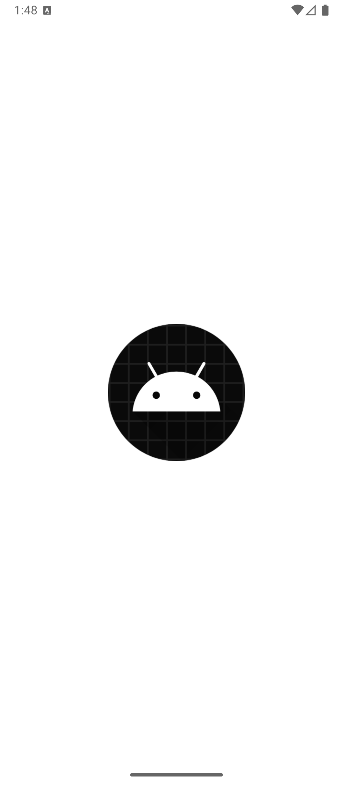
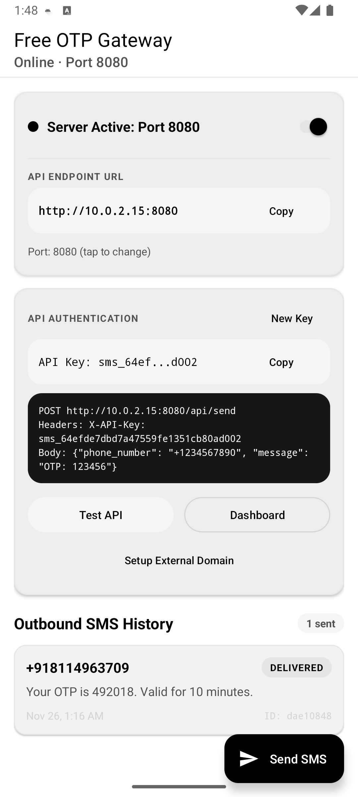

# 📱 Free OTP Gateway — Android SMS & OTP REST Server

<p align="center">
  
  &nbsp;&nbsp;&nbsp;&nbsp;
  
</p>

<p align="center">
  <a href="release/Free-OTP-Gateway.apk">
    
  </a>
</p>

<p align="center">
  
  
  
  
  
</p>

---

## 🌟 Overview

**Free OTP Gateway** turns any Android phone into a high-performance, private SMS gateway and OTP dispatch server. By running an embedded lightweight HTTP server (`NanoHTTPD`) directly on the device, you can send verification codes, transactional alerts, and two-factor authentication (2FA) SMS messages programmatically via standard JSON REST APIs or a built-in browser dashboard.

### Why Free OTP Gateway?

- 💸 **100% Free**: No expensive third-party SMS providers (Twilio, AWS SNS, Msg91). Uses your phone's existing cellular carrier plan and unlimited SMS packs.
- 🛡️ **Privacy by Design**: Requires **only** `SEND_SMS`. Unlike other tools, it **never** requests access to your personal inbox (`READ_SMS`), incoming texts (`RECEIVE_SMS`), contacts, or phone identity. Completely safe from Google Play Protect flags.
- 🎨 **Modern Material 3 UI**: Responsive interface with automatic light/dark theme adaptation, live message feed, active connection indicators, and 1-tap copy shortcuts.
- 🌐 **Embedded Web Dashboard**: Access a full dark-mode web console at `http://<device-ip>:8080/` from any laptop, desktop, or mobile device on your local Wi-Fi.
- 🔋 **24/7 Background Stability**: Equipped with Android foreground services, CPU `WakeLock`, high-performance `WifiLock`, and auto-restart on device reboot.

---

## 🚀 Quick Download & Install

1. Download the latest compiled release:
   👉 **[Download Free-OTP-Gateway.apk](release/Free-OTP-Gateway.apk)** (or [Free-OTP-Gateway-v1.4.apk](release/Free-OTP-Gateway-v1.4.apk))
2. Transfer or download the APK to your Android device and tap **Install**.
3. Launch **Free OTP Gateway** and grant SMS permissions.

### ⚠️ Android 13, 14 & 15 Setup (Restricted Settings)

Modern Android versions enforce extra security for sideloaded apps requesting SMS:
1. When prompted or if SMS access is restricted, open phone **Settings** ➔ **Apps** ➔ **Free OTP Gateway**.
2. Tap the **three dots (⋮)** in the top-right corner.
3. Tap **"Allow restricted settings"** (verify with fingerprint or PIN).
4. Go to **Permissions** ➔ **SMS** ➔ select **Allow**.
5. Return to the app — the server will automatically switch **Online**!

---

## 💻 Web Dashboard

Open your web browser and navigate to:
```text
http://<your-phone-ip>:8080/
```
*(Example: `http://192.168.1.38:8080/`)*

### Dashboard Capabilities
- **Quick OTP Generator**: Generate 4-digit or 6-digit random codes with 1 click.
- **Instant Message Dispatch**: Send SMS directly from your browser.
- **Live Status Feed**: Automatically refreshes every 5 seconds to show delivery statuses (`PENDING`, `SENT`, `DELIVERED`, `FAILED`).
- **Code Snippets**: Copy-paste ready cURL, Python, and JavaScript snippets with your active IP and API key pre-filled.

---

## 📡 REST API Reference

All requests accept and return JSON. The default port is `8080`.

### Authentication
Authenticate requests using any of the following methods:
- **HTTP Header**: `X-API-Key: your_api_key_here`
- **Bearer Token**: `Authorization: Bearer your_api_key_here`
- **Query Parameter**: `?api_key=your_api_key_here`

---

### 1. Send SMS / OTP
Send a single SMS message or OTP to a recipient.

- **Method**: `POST`
- **Endpoint**: `/api/send`
- **Headers**: `Content-Type: application/json`, `X-API-Key: <your_key>`

#### Request Body:
```json
{
  "phone_number": "+918114963709",
  "message": "Your verification code is 492018. Valid for 10 minutes."
}
```

#### Response:
```json
{
  "success": true,
  "message": "SMS queued for sending",
  "sms_id": 2,
  "status": "PENDING",
  "timestamp": 1795635854126
}
```

---

### 2. Check SMS Status
Check whether a message was sent or successfully delivered to the recipient's handset.

- **Method**: `GET`
- **Endpoint**: `/api/status?sms_id=<id>`
- **Headers**: `X-API-Key: <your_key>`

#### Response:
```json
{
  "success": true,
  "sms_id": 2,
  "phone_number": "+918114963709",
  "message": "Your verification code is 492018. Valid for 10 minutes.",
  "status": "DELIVERED",
  "timestamp": 1795635854126,
  "delivery_timestamp": 1795635856659,
  "request_id": "656fe79f-e34b-45e6-bc0f-032b25bdabd7"
}
```

---

### 3. Retrieve Message History
Fetch historical outbound messages with optional limits.

- **Method**: `GET`
- **Endpoint**: `/api/history?limit=20`
- **Headers**: `X-API-Key: <your_key>`

---

### 4. Server Health & Info
Public healthcheck endpoint (no authentication required).

- **Method**: `GET`
- **Endpoint**: `/api/info`

#### Response:
```json
{
  "app_name": "Free OTP Gateway",
  "status": "active",
  "version": "1.3",
  "server_time": 1795635801582,
  "endpoints": ["/api/send", "/api/send-bulk", "/api/status", "/api/history", "/api/info"]
}
```

---

## 🛠️ Code Integration Examples

### cURL
```bash
curl -X POST http://192.168.1.38:8080/api/send \
  -H "Content-Type: application/json" \
  -H "X-API-Key: your_api_key_here" \
  -d '{
    "phone_number": "+918114963709",
    "message": "Your OTP is 593814"
  }'
```

### Python
```python
import requests

url = "http://192.168.1.38:8080/api/send"
headers = {
    "Content-Type": "application/json",
    "X-API-Key": "your_api_key_here"
}
payload = {
    "phone_number": "+918114963709",
    "message": "Your OTP is 593814"
}

response = requests.post(url, headers=headers, json=payload)
print(response.json())
```

### Node.js / JavaScript
```javascript
const response = await fetch("http://192.168.1.38:8080/api/send", {
  method: "POST",
  headers: {
    "Content-Type": "application/json",
    "X-API-Key": "your_api_key_here"
  },
  body: JSON.stringify({
    phone_number: "+918114963709",
    message: "Your OTP is 593814"
  })
});

const data = await response.json();
console.log(data);
```

### PHP
```php
<?php
$curl = curl_init();
curl_setopt_array($curl, [
    CURLOPT_URL => "http://192.168.1.38:8080/api/send",
    CURLOPT_RETURNTRANSFER => true,
    CURLOPT_POST => true,
    CURLOPT_POSTFIELDS => json_encode([
        "phone_number" => "+918114963709",
        "message" => "Your OTP is 593814"
    ]),
    CURLOPT_HTTPHEADER => [
        "Content-Type: application/json",
        "X-API-Key: your_api_key_here"
    ],
]);
$response = curl_exec($curl);
curl_close($curl);
echo $response;
?>
```

---

## 🌐 Global Internet Access (Reverse Proxy)

To access your phone gateway from outside your local Wi-Fi:
1. **Cloudflare Tunnel (Recommended & Free)**:
   Install `cloudflared` on your PC or local server connected to the same Wi-Fi:
   ```bash
   cloudflared tunnel --url http://192.168.1.38:8080
   ```
2. **Nginx Reverse Proxy / VPS**:
   Forward requests from your public domain (`sms.yourdomain.com`) directly to your phone via WireGuard or local port forwarding.
3. In the mobile app, tap **"Setup External Domain"** to set your public URL.

---

## 🔨 Building from Source

```bash
# Clone this repository
git clone https://github.com/sk-mallick/Free-OTP-Gateway.git
cd Free-OTP-Gateway

# Build release and debug APKs using Gradle
./gradlew assembleRelease assembleDebug
```
The compiled APK will be generated at `app/build/outputs/apk/release/app-release.apk`.

---

## 👤 Author & License

Created and maintained by **Subham Kumar Mallick** ([@sk-mallick](https://github.com/sk-mallick)).

Distributed under the **MIT License**. See [LICENSE](LICENSE) for details.
